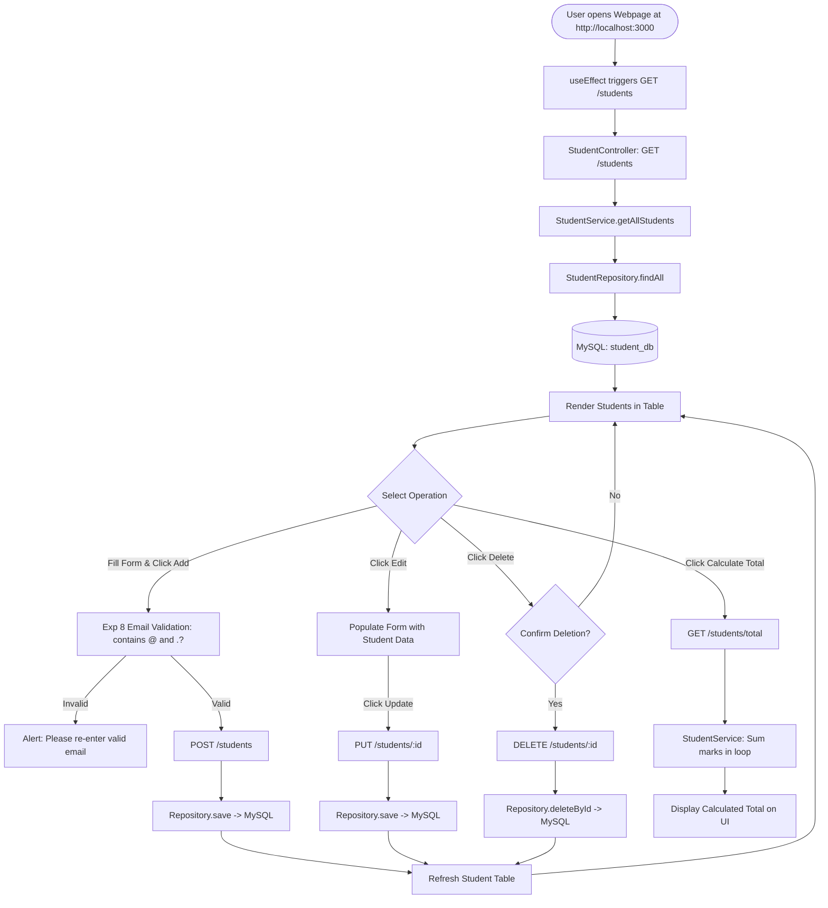
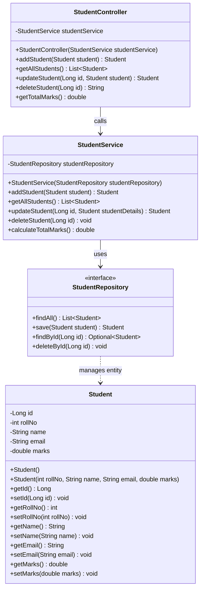

# Student Management System (Mini Project)

A beginner-friendly, Level-1 Full-Stack **Student Management System** developed directly aligned with Experiments 1 to 10 taught in the syllabus.

Built using: **React**, **CSS**, **Java Spring Boot**, **Spring Data JPA / JDBC Connectivity**, and **MySQL**.

---

## Index / Table of Contents

| Sr. No. | Section |
| :---: | :--- |
| **1** | [Title, Description & Objectives](#1-title-description--objectives) |
| **2** | [Tools & Technologies](#2-tools--technologies) |
| **3** | [System Design – Flowchart & Class Diagram](#3-system-design--flowchart--class-diagram) |
| **4** | [Features, Frontend & Database Design](#4-features-frontend--database-design) |
| **5** | [Backend Design & Workflow](#5-backend-design--workflow) |
| **6** | [Sample Code Snippets](#6-sample-code-snippets) |
| **7** | [Output Screenshots](#7-output-screenshots) |
| **8** | [Conclusion & Future Scope](#8-conclusion--future-scope) |
| **9** | [How to Run the Project](#9-how-to-run-the-project) |

---

## 1. Title, Description & Objectives

### Project Title
**Student Management System**

### Description
The Student Management System is an end-to-end, Level-1 monolithic web application designed to demonstrate the core competencies covered across laboratory Experiments 1 through 10. The system enables users to create, view, update, and delete student records (`rollNo`, `name`, `email`, `marks`), calculate total marks across all students, and validate input data directly on the client side.

The architecture mirrors the exact 4-tier monolithic structure taught in class:
$$\text{Client (React)} \longleftrightarrow \text{Controller} \longleftrightarrow \text{Service} \longleftrightarrow \text{Repository} \longleftrightarrow \text{JPA / Database (MySQL)}$$

### Objectives
1. **Apply Object-Oriented Fundamentals (Exp 1 & Exp 2)**: Model student entities with encapsulated fields, default constructors, parameterized constructors, and getters/setters.
2. **Implement Client-Side Web Interface (Exp 5, 7, 8 & Exp 9)**: Construct a clean, accessible user interface using HTML table/form semantics, CSS styling, client-side email format validation (checking `@` and `.`), and dynamic React hooks (`useState`, `useEffect`).
3. **Enterprise Monolithic Backend Architecture (Exp 6 & Exp 10)**: Build a RESTful Spring Boot application following the standard layered package structure (`entity`, `repository`, `service`, `controller`).
4. **Relational Database Persistence (Exp 10)**: Connect to a MySQL relational database via Spring Boot's datasource configuration (`spring.datasource.url`), mapping entities directly to relational tables.

---

## 2. Tools & Technologies

| Category | Technology / Tool | Version / Details | Purpose | Direct Syllabus Link |
| :--- | :--- | :--- | :--- | :--- |
| **Frontend UI** | React.js | 18.x | Component-based interactive UI, `useState` hook for state, `useEffect` for lifecycle API calls | **Experiment 9** |
| **Validation** | JavaScript | ES6 | Form handling and email validation checking presence of `@` and `.` | **Experiment 8** |
| **Styling** | Plain CSS | CSS3 | Responsive card layouts, form controls, table grid design | **Experiment 5 & 7** |
| **Backend Language** | Java | JDK 17 / 21 | Core programming language, OOP classes and objects | **Experiment 1 & 2** |
| **Backend Framework** | Spring Boot | 3.2.x | Monolithic framework, embedded Apache Tomcat, RESTful APIs | **Experiment 6 & 10** |
| **Persistence / ORM** | Spring Data JPA / Hibernate | JPA 3.x | Auto-creates tables (`ddl-auto=update`), handles database operations without writing complex SQL | **Experiment 10** |
| **Database** | MySQL | MySQL 8.0+ | Relational storage for student records (`student_db`) | **Experiment 10** |
| **Build Tool** | Apache Maven | 3.x | Build automation, dependency management via `pom.xml` | **Experiment 10** |
| **Development IDE** | VS Code / Eclipse | Standard | IDE with Spring Boot and Thunder Client support | **Experiment 5 & 10** |

---

## 3. System Design – Flowchart & Class Diagram

### 3.1 Flowchart



---

### 3.2 Class Diagram



---

## 4. Features, Frontend & Database Design

### 4.1 Key Features
- **Student Registration (Create)**: Capture roll number, name, email, and marks.
- **Client-Side Validation (Exp 8)**: Custom JavaScript validation verifying the presence of `@` and `.` characters in the email input before submitting.
- **Student Directory (Read)**: Tabular presentation displaying all active records.
- **Record Modification (Update)**: In-place form population allowing instant edits and updates.
- **Record Removal (Delete)**: Safe deletion prompt using browser dialog confirmation.
- **Aggregate Calculation (Exp 10)**: Server-side loop calculation summing marks across all enrolled students (`calculateTotalMarks()`).

### 4.2 Frontend Design (React + CSS)
The user interface is contained inside [`frontend/src/App.js`](file:///home/abek_shek/Desktop/student_managment/frontend/src/App.js) and styled via [`frontend/src/App.css`](file:///home/abek_shek/Desktop/student_managment/frontend/src/App.css):
- **Form Card**: Header "Add New Student" or "Update Student Record" with standard input fields and action buttons.
- **Table Card**: Styled table with columns `ID`, `Roll No`, `Name`, `Email`, `Marks`, and `Actions`.
- **Summary Box**: Dedicated button and highlighted card for displaying the total marks calculation.

### 4.3 Database Design (MySQL)

#### Database: `student_db`
#### Table: `student` (Auto-generated by Hibernate from `@Entity Student`)

| Column Name | SQL Type | Constraints | Description | Syllabus Field Origin |
| :--- | :--- | :--- | :--- | :--- |
| `id` | `BIGINT` | `PRIMARY KEY, AUTO_INCREMENT` | Unique system identifier | Exp 10 (`Long id`) |
| `roll_no` | `INT` | `NOT NULL` | Student academic roll number | Exp 1 (`int rollNo`) |
| `name` | `VARCHAR(255)` | `NOT NULL` | Full student name | Exp 1 (`String name`) |
| `email` | `VARCHAR(255)` | `NOT NULL` | Email address validated for `@` and `.` | Exp 8 (Email Validation) |
| `marks` | `DOUBLE` | `NOT NULL` | Numerical marks used for aggregation | Exp 10 (`double amount` pattern) |

---

## 5. Backend Design & Workflow

The backend strictly follows the **5-component monolithic pattern** taught in Experiment 10:

1. **`Student.java` (Entity Package)**:
   Annotated with `@Entity`, `@Id`, and `@GeneratedValue(strategy = GenerationType.IDENTITY)`. Represents the schema.
2. **`StudentRepository.java` (Repository Package)**:
   An interface extending `JpaRepository<Student, Long>`, providing pre-built database CRUD methods (`save`, `findAll`, `findById`, `deleteById`).
3. **`StudentService.java` (Service Package)**:
   Annotated with `@Service`. Encapsulates business logic, including iterating over all records with a `for` loop to compute the aggregate total.
4. **`StudentController.java` (Controller Package)**:
   Annotated with `@RestController`, `@RequestMapping("/students")`, and `@CrossOrigin(origins = "*")`. Exposes REST API endpoints.
5. **`application.properties` (Resources)**:
   Configures the MySQL database URL, database credentials, `ddl-auto=update`, and `server.port=8080`.

### REST API Endpoints

| HTTP Method | Route | Description | Request Body | Response Format |
| :--- | :--- | :--- | :--- | :--- |
| **GET** | `/students` | Get list of all students | None | `JSON Array of Students` |
| **POST** | `/students` | Register a new student | `Student JSON` | `Created Student JSON` |
| **PUT** | `/students/{id}` | Update an existing student | `Student JSON` | `Updated Student JSON` |
| **DELETE** | `/students/{id}` | Delete a student by ID | None | `String ("Student deleted successfully")` |
| **GET** | `/students/total` | Calculate total marks | None | `double (e.g. 260.5)` |

---

## 6. Sample Code Snippets

### 6.1 Entity Layer (`Student.java`)
```java
package com.example.student.entity;

import jakarta.persistence.Entity;
import jakarta.persistence.GeneratedValue;
import jakarta.persistence.GenerationType;
import jakarta.persistence.Id;

@Entity
public class Student {

    @Id
    @GeneratedValue(strategy = GenerationType.IDENTITY)
    private Long id;

    private int rollNo;
    private String name;
    private String email;
    private double marks;

    public Student() {}

    public Student(int rollNo, String name, String email, double marks) {
        this.rollNo = rollNo;
        this.name = name;
        this.email = email;
        this.marks = marks;
    }

    // Getters and Setters
    public Long getId() { return id; }
    public void setId(Long id) { this.id = id; }
    public int getRollNo() { return rollNo; }
    public void setRollNo(int rollNo) { this.rollNo = rollNo; }
    public String getName() { return name; }
    public void setName(String name) { this.name = name; }
    public String getEmail() { return email; }
    public void setEmail(String email) { this.email = email; }
    public double getMarks() { return marks; }
    public void setMarks(double marks) { this.marks = marks; }
}
```

### 6.2 Service Layer with Calculation Logic (`StudentService.java`)
```java
package com.example.student.service;

import com.example.student.entity.Student;
import com.example.student.repository.StudentRepository;
import org.springframework.stereotype.Service;
import java.util.List;

@Service
public class StudentService {

    private final StudentRepository studentRepository;

    public StudentService(StudentRepository studentRepository) {
        this.studentRepository = studentRepository;
    }

    public Student addStudent(Student student) {
        return studentRepository.save(student);
    }

    public List<Student> getAllStudents() {
        return studentRepository.findAll();
    }

    public double calculateTotalMarks() {
        List<Student> students = studentRepository.findAll();
        double total = 0;
        for (Student student : students) {
            total = total + student.getMarks();
        }
        return total;
    }
}
```

### 6.3 React Component with Validation & Hooks (`App.js`)
```javascript
// Experiment 8: Email validation logic
const validateEmail = (emailInput) => {
  if (emailInput.indexOf('@') === -1 || emailInput.indexOf('.') === -1) {
    alert("Invalid Email! Email must contain '@' and '.' characters. Please re-enter.");
    return false;
  }
  return true;
};

// Experiment 9: useState Hook for managing form data
const [rollNo, setRollNo] = useState('');
const [name, setName] = useState('');
const [email, setEmail] = useState('');
const [marks, setMarks] = useState('');
```

---

## 7. Output Screenshots

*(Use this section for your Lab Submission Document / Project Report)*

### 1. Web Application User Interface
```
+-----------------------------------------------------------------------------------------+
|                                Student Management System                                |
|        Basic Monolithic Project (Spring Boot + JPA + MySQL + React + CSS)               |
+-----------------------------------------------------------------------------------------+
|  Add New Student                                                                        |
|  Roll Number:                          [ 101                      ]                     |
|  Student Name:                         [ Rahul Sharma             ]                     |
|  Email Address (Exp 8 Validation):     [ rahul@gmail.com          ]                     |
|  Marks:                                [ 88.5                     ]                     |
|  [ Add Student ]                                                                        |
+-----------------------------------------------------------------------------------------+
|  Student Records                                                                        |
|  +----+---------+------------------+-------------------+-------+---------------------+  |
|  | ID | Roll No | Name             | Email             | Marks | Actions             |  |
|  +----+---------+------------------+-------------------+-------+---------------------+  |
|  | 1  | 101     | Rahul Sharma     | rahul@gmail.com   | 88.5  | [ Edit ] [ Delete ] |  |
|  | 2  | 102     | Sneha Patil      | sneha@gmail.com   | 92.0  | [ Edit ] [ Delete ] |  |
|  +----+---------+------------------+-------------------+-------+---------------------+  |
|                                                                                         |
|  [ Calculate Total Marks ]                                                              |
|  Total Marks of All Students: ₹180.5 / 180.5 pts                                        |
+-----------------------------------------------------------------------------------------+
```

### 2. Validation Alert (Experiment 8)
When entering an email lacking `@` or `.` (e.g. `rahulgmailcom`):
```
+-----------------------------------------------------------------------+
|  Alert: Invalid Email! Email must contain '@' and '.' characters.     |
|         Please re-enter.                                              |
+-----------------------------------------------------------------------+
```

### 3. Thunder Client / REST API Verification
- `POST http://localhost:8080/students` $\longrightarrow$ `200 OK` (Record inserted into MySQL)
- `GET http://localhost:8080/students/total` $\longrightarrow$ `180.5` (Computed sum of all students' marks)

---

## 8. Conclusion & Future Scope

### Conclusion
The **Student Management System** provides a complete practical realization of the software development syllabus:
- **Object-Oriented Programming (Exp 1 & 2)** is applied via proper class design, encapsulation, and constructors.
- **Client-Side Technologies (Exp 5, 7, 8 & 9)** are integrated through responsive styling, event-driven user actions, email validation, and React hooks.
- **Enterprise Spring Boot Architecture (Exp 6 & 10)** is implemented using a 4-tier monolithic architecture (`Controller` $\to$ `Service` $\to$ `Repository` $\to$ `MySQL`), including relational mapping and automated schema updates.

The codebase is free of over-engineering, making each line directly traceable to classroom experiments and ready for viva defense.

### Future Scope
1. **Search & Filter Operations**: Add client-side filtering by roll number or student name.
2. **Grade Calculation**: Extend the service layer to assign grades (A, B, C) based on marks.
3. **Pagination Support**: Support paginated queries for managing large batches of students.
4. **Export Options**: Export the student roster into downloadable CSV or PDF reports.

---

## 9. How to Run the Project

### Prerequisites
Make sure the following tools are installed:
- **Java JDK (17 or 21)**: Check using `java -version`
- **Apache Maven**: Check using `mvn -v`
- **Node.js & npm**: Check using `node -v` and `npm -v`
- **MySQL Server**: Ensure MySQL service is running

---

### Step 1: Set up MySQL Database
1. Open the terminal or Command Prompt and log in to MySQL:
   ```bash
   sudo mysql
   ```
   *(or `mysql -u root -p` on Windows)*

2. Create the project database:
   ```sql
   CREATE DATABASE IF NOT EXISTS student_db;
   SHOW DATABASES;
   EXIT;
   ```
   *(Note: Hibernate automatically creates and updates the `student` table with all columns when Spring Boot starts up).*

3. *(Optional)* Verify database credentials inside [`backend/src/main/resources/application.properties`](file:///home/abek_shek/Desktop/student_managment/backend/src/main/resources/application.properties):
   ```properties
   spring.datasource.url=jdbc:mysql://localhost:3306/student_db?createDatabaseIfNotExist=true&useSSL=false&allowPublicKeyRetrieval=true
   spring.datasource.username=root
   spring.datasource.password=root
   ```
   *(Update username and password if your local MySQL uses different credentials).*

---

### Step 2: Run the Spring Boot Backend
1. Open a terminal and navigate to the `backend` directory:
   ```bash
   cd /home/abek_shek/Desktop/student_managment/backend
   ```

2. Start the application using Maven:
   ```bash
   mvn spring-boot:run
   ```

3. Look for the startup message in the terminal:
   ```text
   Started StudentAppApplication on port 8080
   ```
   Backend APIs are now live and accessible at: **`http://localhost:8080`**

---

### Step 3: Run the React Frontend
1. Open a second terminal and navigate to the `frontend` directory:
   ```bash
   cd /home/abek_shek/Desktop/student_managment/frontend
   ```

2. Install dependencies (only required the first time):
   ```bash
   npm install
   ```

3. Start the React development server (either command works):
   ```bash
   npm start
   # or
   npm run dev
   ```

4. The browser will automatically open:
   **`http://localhost:3000`**

---

### Step 4: Test the Application
1. **Add Student**: Enter Roll No, Name, Email (must have `@` and `.`), and Marks, then click **Add Student**.
2. **View Students**: The new student appears immediately in the table below.
3. **Edit Student**: Click **Edit** next to any record, modify the values in the form, and click **Update Student**.
4. **Delete Student**: Click **Delete** next to any student and confirm the alert popup.
5. **Calculate Total Marks**: Click **Calculate Total Marks** to invoke the backend business logic and view the sum of marks.

